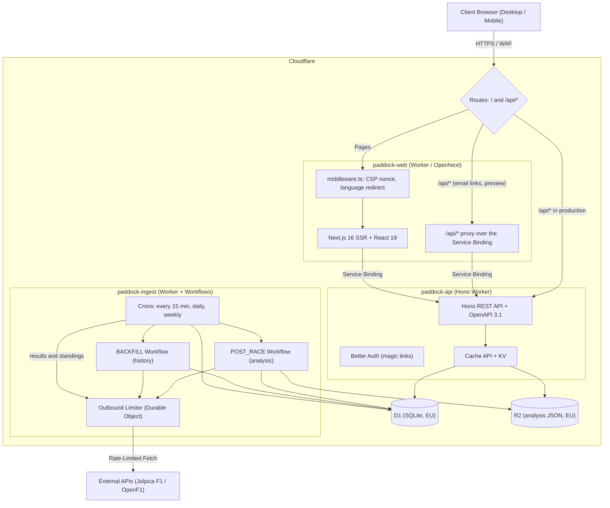

# Paddock Notes

> An unofficial site that explains Formula 1 with data, built on Cloudflare Workers with Next.js 16, React 19, Hono and Drizzle ORM.

[](https://www.typescriptlang.org/)
[](https://nextjs.org/)
[](https://workers.cloudflare.com/)
[](https://www.w3.org/WAI/standards-guidelines/wcag/)
[](LICENSE)

Paddock Notes turns Formula 1 results and timing data into charts and plain explanations: the current season race by race, post-race analysis of strategy, pace and telemetry for every race since 2023, a what-if championship simulator, and explainers and a glossary for newer fans. The whole product is written in English, Spanish and German.

*A personal and non-commercial portfolio project. Unofficial and not affiliated with Formula 1, the FIA, or Formula 1 teams.*

**This repository is public on purpose as a portfolio work sample.** If you are a recruiter or hiring manager reading this, treat it as concrete evidence of engineering practice: modern serverless edge architecture, progressive enhancement, WCAG 2.2 AA accessibility, and architectural boundaries enforced by tests.

A few places worth a direct look in the codebase:
- [`packages/db/test/architecture.test.ts`](packages/db/test/architecture.test.ts): Read/write separation for D1 (D-14). CI fails if the API or the web app imports the F1 write module.
- [`packages/analysis/src/`](packages/analysis/src/): Pure TypeScript analysis: telemetry resampled by distance, a linear pace trend per stint, safety car detection and braking zones, under a 300 kB budget per telemetry view (TEC-13).
- [`apps/web/middleware.ts`](apps/web/middleware.ts): A fresh CSP nonce on every request with no `'unsafe-inline'` scripts (D-04), plus the language redirect by country (D-36).
- [`workers/ingest/src/limiter.ts`](workers/ingest/src/limiter.ts): Outbound rate limiter coordinated via Cloudflare Durable Objects (D-10).
- [`e2e/tests/site.spec.ts`](e2e/tests/site.spec.ts): Playwright and axe on desktop, mobile and dark mode, including pages with JavaScript turned off.
- [`docs/decisions.md`](docs/decisions.md): 36 decisions, each with its context, what was ruled out and why.

---

## Technical Highlights

- **Three Workers, one platform:** web, API and ingestion are separate Cloudflare Workers. The web app talks to the API over a Service Binding, and only the ingestion Worker ever calls an external source (D-05).
- **Read/write separation (D-14):** D1 has no read-only bindings, so the separation lives in code: a lint rule and an architecture test stop the API and the web app from importing the write module.
- **Precomputed analysis (D-08):** after each race a Workflow pulls OpenF1 data, computes the five analyses in TypeScript and stores versioned JSON in R2. Telemetry is resampled by distance to stay under 300 kB per view (TEC-13); no page waits on an external API.
- **Security by default:** a per-request nonce CSP, Zod validation of every external response before it reaches D1, a closed list of outbound hosts, a shared outbound rate limiter in a Durable Object, passwordless magic-link sign-in and RFC 8058 one-click unsubscribe.
- **Accessibility and progressive enhancement:** WCAG 2.2 AA as the target, checked with axe on every page in the browser tests, with two documented exceptions (D-27, D-33). The simulator, season picker, quiz and head to head all work with JavaScript turned off.
- **Three languages (D-29, D-36):** every string and article is written separately in English, Spanish and German. `/` redirects by the visitor's country (`cf-ipcountry`), then by `Accept-Language`, with English as the fallback.

---

## Architecture Overview



---

## Monorepo Structure

The repository is organized as a pnpm workspace with strict boundary isolation:

| Package / Application | Technology | Responsibility |
|---|---|---|
| `apps/web` | Next.js 16, React 19, OpenNext | Server-rendered frontend, localized routes (`/en`, `/es`, `/de`), and dynamic nonce injection |
| `workers/api` | Hono, Better Auth, Zod | Public REST API (`/api/v1`), OpenAPI documentation, authenticated user profiles, and rate limiting |
| `workers/ingest` | Cloudflare Workflows, Durable Objects | Autonomous data ingestion, OpenF1 telemetry processing, scheduled mailings, and data backfill |
| `packages/analysis` | Pure TypeScript | Post-race analysis: telemetry resampling, pace trends per stint, safety car periods, braking zones and sectors |
| `packages/db` | Drizzle ORM, Cloudflare D1 | Relational database schema, schema migrations, and isolated read and write repository layers (D-14) |
| `packages/shared` | TypeScript, Zod | Shared validation schemas, Jolpica and OpenF1 data normalization, and email rendering templates |
| `e2e/` | Playwright, axe-core | End-to-end user journeys, WCAG 2.2 AA accessibility auditing, keyboard navigation, and dark mode tests |
| `fixtures/` | JSON Fixtures | Real responses from Jolpica F1 and OpenF1 for hermetic test execution |

---

## Core Features

### 1. Active Season & Race Hub
- **Next Grand Prix:** countdown and every session in the visitor's time zone and the circuit's.
- **Race pages:** result, qualifying, sprint, pit stops and weather, with OpenF1's provisional result minutes after the flag until Jolpica publishes the official one (D-31).
- **Circuits:** the season map, and a circuit page with the fastest lap animated at real pace, braking zones and a globe with the local time.

### 2. History and profiles
- **Profiles:** drivers, constructors and circuits, each stating which seasons its figures cover. The history is loaded season by season from Jolpica, so records stay hidden until it reaches 1950 (D-34).
- **Points recalculator (HIS-06):** any season recalculated under today's points system, always labelled as a recalculation.
- **Head to head (D-35):** two drivers compared within the current season, race by race, picked from the championship grid.

### 3. Technical zone (races since 2023)
- **Strategy and pace:** stints, compounds and stops; lap times with in and out laps and neutralised laps filtered out, and a trend line per stint.
- **Telemetry:** two drivers' fastest laps side by side (speed, throttle, brake, gear, delta), synchronised and navigable with the keyboard.
- **Sectors and replay:** a driver × sector matrix and lap-by-lap positions, each chart with an automatic note that never invents causes (TEC-08).

### 4. Interactive & Community Tools
- **Championship simulator:** a what-if for the remaining races with a shareable URL, no JavaScript needed.
- **Weekly quiz:** five questions with explanations, playable without an account or JavaScript; with an account it keeps a streak.
- **Privacy-First Accounts & Leagues:** Passwordless authentication via magic links, private prediction leagues, and one-click data export/deletion.

---

## Engineering Decisions & Documentation

Technical architectural decisions are documented in detail within the [`docs/`](docs/README.md) directory:

- [Decision log](docs/decisions.md): the reasoning behind 36 decisions, including the ones that were later superseded.
- [Security Architecture](docs/security.md): Threat model, Content Security Policy, CSRF protection, and data privacy policies.
- [Feature Specifications](docs/features.md): Functional and non-functional requirements.
- [Brand & Design Guidelines](docs/brand.md): Typography, color contrast requirements, and motion standards.
- [Implementation Status](docs/status.md): Traceability matrix covering implemented milestones.
- [`PRODUCT.md`](PRODUCT.md) and [`DESIGN.md`](DESIGN.md): who the product is for, its voice, and the design system in one page each.

---

## Local Development

### Prerequisites
- Node.js 22 or higher
- pnpm 10 or higher

### Setup & Run

1. Clone and install dependencies:
   ```sh
   git clone https://github.com/marcmendezb/paddock-notes.git
   cd paddock-notes
   pnpm install
   ```

2. Build the web app's Worker bundle (the local stack serves it with `wrangler dev`):
   ```sh
   pnpm --filter @paddock/web build:worker
   ```

3. Launch the full local edge stack:
   ```sh
   scripts/local-stack.sh --seed
   ```
   *`--seed` runs the daily ingestion job once, which loads the current season from Jolpica F1 into the local D1. The script also fires the ingestion crons while it runs (`--no-cron` turns them off).*

4. Access the services:
   - **Web App:** http://localhost:8789/en
   - **Public API:** http://localhost:8787/api/v1/seasons/2026/schedule
   - **OpenAPI Docs:** http://localhost:8787/api/v1/docs

### Local Environment Variables

To test authenticated community features locally, create `workers/api/.dev.vars`:

```sh
AUTH_SECRET=0123456789abcdef0123456789abcdef0123456789abcdef0123456789abcdef
TURNSTILE_SECRET=1x0000000000000000000000000000000AA
AUTH_BASE_URL=http://localhost:8789
TRUSTED_ORIGINS=http://localhost:8789,http://localhost:8787
SITE_URL=http://localhost:8789
```

*Locally, outgoing emails (magic links, newsletters, notifications) are intercepted and written as plain text files under `workers/*/.wrangler/tmp/email/`.*

---

## Quality Assurance & Testing

```sh
# Static analysis and linting (enforces D-14 architectural boundaries)
pnpm lint

# TypeScript verification across all 7 workspace packages
pnpm typecheck

# Unit and Workers tests (Vitest; the Workers suites run in workerd)
pnpm test

# End-to-end accessibility and functional tests (Playwright + axe-core)
pnpm --filter @paddock/e2e e2e

# Dependency security vulnerability audit
pnpm audit --audit-level high
```

`pnpm check` runs lint, types and unit tests in one go. CI on GitHub Actions runs the same on every pull request and push to `main`, plus the Worker builds and a gitleaks scan. Deploys wait for the `CLOUDFLARE_READY` repository variable, so the site is not live yet ([docs/setup.md](docs/setup.md)).

---

## Licenses & Data Attribution

- **Source Code:** [MIT](LICENSE)
- **Formula 1 Data:** [Jolpica F1](https://jolpi.ca/) and [OpenF1](https://openf1.org/), licensed under [CC BY-NC-SA 4.0](https://creativecommons.org/licenses/by-nc-sa/4.0/). All derived analytics published under the same non-commercial license (ADR D-12).
- **Geographic Outlines:** Natural Earth (Public Domain).
- **Typography:** Archivo by Omnibus-Type, licensed under SIL Open Font License.

---

## Author

**Marc Mendez**  
Full-stack developer & MarTech specialist. Seven years in marketing, three building products. Based near Zürich, Switzerland.

- Portfolio: [marcmendezb.com](https://marcmendezb.com)
- GitHub: [@marcmendezb](https://github.com/marcmendezb)
- Email: [marcmendezb@gmail.com](mailto:marcmendezb@gmail.com)
