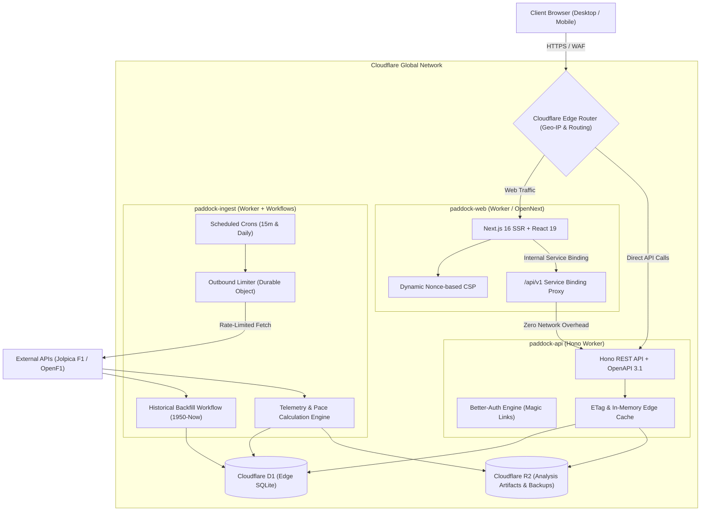

# Paddock Notes

> A high-performance Formula 1 data analytics and historical archive platform built on the Cloudflare edge stack with Next.js 16, React 19, Hono, and Drizzle ORM.

[](https://www.typescriptlang.org/)
[](https://nextjs.org/)
[](https://workers.cloudflare.com/)
[](https://www.w3.org/WAI/standards-guidelines/wcag/)
[](LICENSE)

Paddock Notes transforms 75 years of Formula 1 telemetry and race results into interactive, accessible, and fast insights. It provides race-by-race telemetry analysis, historical statistics since 1950, real-time championship simulations, and technical explainers.

*A personal and non-commercial portfolio project. Unofficial and not affiliated with Formula 1, the FIA, or Formula 1 teams.*

---

## Technical Highlights

- **Edge-Native Architecture:** 100% serverless edge deployment across three dedicated Cloudflare Workers communicating over ultra-low-latency Service Bindings.
- **Strict CQRS Read/Write Separation (ADR D-14):** An automated architectural test scans imports during CI to guarantee public API and web render layers never import mutation or ingestion modules.
- **Telemetry Downsampling Engine (TEC-13):** High-frequency OpenF1 telemetry streams (car speed, throttle, brake, coordinates) are downsampled and compressed using custom ordinary least squares (OLS) regressions and spatial clustering to satisfy a strict `<300 KB` payload budget.
- **Enterprise Security Model:** Per-request dynamic nonce-based Content Security Policy (CSP) with zero `'unsafe-inline'` allowances, RFC 8058 one-click list unsubscribes, Cloudflare Turnstile bot verification, and passwordless authentication with magic links.
- **Accessibility & Progressive Enhancement:** Certified WCAG 2.2 AA with automated axe-core regression tests in Playwright. Critical interactive tools (championship simulator, season picker, weekly quiz, and head-to-head comparisons) function completely with client-side JavaScript disabled.
- **Edge Geo-Routing & Trilingual i18n (ADR D-36):** Automatic locale negotiation powered by Cloudflare `cf-ipcountry` headers with language fallback across English, Spanish, and German.

---

## Architecture Overview



---

## Monorepo Structure

The repository is organized as a pnpm workspace with strict boundary isolation:

| Package / Application | Technology | Responsibility |
|---|---|---|
| `apps/web` | Next.js 16, React 19, OpenNext | Server-rendered frontend, localized routes (`/en`, `/es`, `/de`), and dynamic nonce injection |
| `workers/api` | Hono, Better Auth, Zod | Public REST API (`/api/v1`), OpenAPI documentation, authenticated user profiles, and rate limiting |
| `workers/ingest` | Cloudflare Workflows, Durable Objects | Autonomous data ingestion, OpenF1 telemetry processing, scheduled mailings, and data backfill |
| `packages/analysis` | Pure TypeScript | Mathematics engine for telemetry reduction, OLS pace regressions, corner braking zones, and tyre degradation |
| `packages/db` | Drizzle ORM, Cloudflare D1 | Relational database schema, schema migrations, and isolated read and write repository layers (D-14) |
| `packages/shared` | TypeScript, Zod | Shared validation schemas, Jolpica and OpenF1 data normalization, and email rendering templates |
| `e2e/` | Playwright, axe-core | End-to-end user journeys, WCAG 2.2 AA accessibility auditing, keyboard navigation, and dark mode tests |
| `fixtures/` | JSON Fixtures | Real responses from Jolpica F1 and OpenF1 for hermetic test execution |

---

## Core Features

### 1. Active Season & Race Hub
- **Interactive Countdown:** Next Grand Prix session schedule automatically translated to visitor's local timezone.
- **Race Weather & Neutralizations:** Detection of VSC (Virtual Safety Car), Safety Car, and Red Flag periods.
- **Circuit Venue Maps:** Season calendar with interactive geographic circuit mapping.

### 2. Historical Archive (1950-Present)
- **75 Years of Grand Prix History:** Driver, constructor, and circuit profiles with career timelines and records.
- **Point System Recalculator (ADR HIS-06):** Historic seasons recalculated under modern scoring rules to compare championship battles across eras.
- **Head-to-Head Compare:** Teammate and contender duels with qualifying and race finish head-to-heads.

### 3. Technical Analysis Zone (Post-2023)
- **Pace Analysis:** Outlier lap filtering (pit laps, safety car deltas, yellow flags) with compound degradation regression curves.
- **Braking Zone Detection:** Automated discovery of heavy braking zones based on telemetry inflection points and minimum speed valleys.
- **Telemetry Visualizer:** Synchronized dual-lap speed, throttle, braking, and gear telemetry viewer navigable via keyboard.

### 4. Interactive & Community Tools
- **Championship Title Simulator:** Zero-JS scenario modeler calculating mathematical title contention scenarios.
- **Weekly F1 Quiz:** Interactive trivia with streak tracking, state persistence, and full functionality with JavaScript disabled.
- **Privacy-First Accounts & Leagues:** Passwordless authentication via magic links, private prediction leagues, and one-click data export/deletion.

---

## Engineering Decisions & Documentation

Technical architectural decisions are documented in detail within the [`docs/`](docs/README.md) directory:

- [Architecture Decision Records (ADRs)](docs/decisions.md): Complete rationale for 36 architectural decisions.
- [Security Architecture](docs/security.md): Threat model, Content Security Policy, CSRF protection, and data privacy policies.
- [Feature Specifications](docs/features.md): Functional and non-functional requirements.
- [Brand & Design Guidelines](docs/brand.md): Typography, color contrast requirements, and motion standards.
- [Implementation Status](docs/status.md): Traceability matrix covering implemented milestones.

---

## Local Development

### Prerequisites
- Node.js 22 or higher
- pnpm 10 or higher

### Setup & Run

1. Clone and install dependencies:
   ```sh
   git clone https://github.com/marcmendezb/paddock-notes.git
   cd paddock-notes
   pnpm install
   ```

2. Build the Next.js Worker bundle:
   ```sh
   pnpm --filter @paddock/web build:worker
   ```

3. Launch the full local edge stack:
   ```sh
   scripts/local-stack.sh --seed
   ```
   *The `--seed` flag populates the shared local D1 SQLite database with real season data from Jolpica F1.*

4. Access the services:
   - **Web App:** http://localhost:8789/en
   - **Public API:** http://localhost:8787/api/v1/seasons/2026/schedule
   - **OpenAPI Docs:** http://localhost:8787/docs

### Local Environment Variables

To test authenticated community features locally, create `workers/api/.dev.vars`:

```sh
AUTH_SECRET=0123456789abcdef0123456789abcdef0123456789abcdef0123456789abcdef
TURNSTILE_SECRET=1x0000000000000000000000000000000AA
AUTH_BASE_URL=http://localhost:8789
TRUSTED_ORIGINS=http://localhost:8789,http://localhost:8787
SITE_URL=http://localhost:8789
```

*Locally, outgoing emails (magic links, newsletters, notifications) are intercepted and written as plain text files under `workers/*/.wrangler/tmp/email/`.*

---

## Quality Assurance & Testing

```sh
# Static analysis and linting (enforces D-14 architectural boundaries)
pnpm lint

# TypeScript verification across all 7 workspace packages
pnpm typecheck

# Unit and integration test suites (Vitest running inside workerd runtime)
pnpm test

# End-to-end accessibility and functional tests (Playwright + axe-core)
pnpm --filter @paddock/e2e e2e

# Dependency security vulnerability audit
pnpm audit --audit-level high
```

Continuous Integration runs on GitHub Actions on every pull request and push to `main`, executing full type checking, linting, tests, worker builds, and Gitleaks secret scans.

---

## Licenses & Data Attribution

- **Source Code:** [MIT](LICENSE)
- **Formula 1 Data:** [Jolpica F1](https://jolpi.ca/) and [OpenF1](https://openf1.org/), licensed under [CC BY-NC-SA 4.0](https://creativecommons.org/licenses/by-nc-sa/4.0/). All derived analytics published under the same non-commercial license (ADR D-12).
- **Geographic Outlines:** Natural Earth (Public Domain).
- **Typography:** Archivo by Omnibus-Type, licensed under SIL Open Font License.

---

## Author

**Marc Méndez**  
Full Stack & Cloudflare Edge Engineer  
- GitHub: [@marcmendezb](https://github.com/marcmendezb)  
- Email: [marcmendezb@gmail.com](mailto:marcmendezb@gmail.com)
