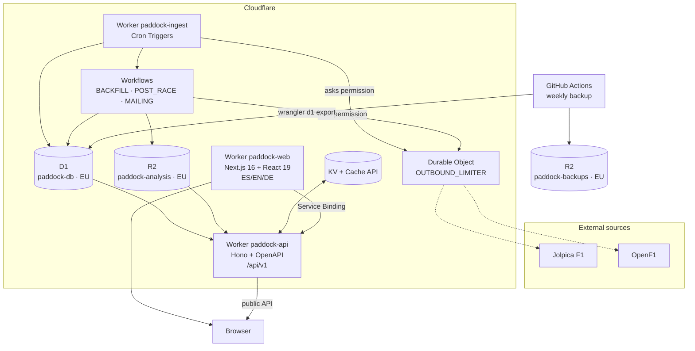

# Paddock Notes: technical stack and Cloudflare deployment

> The full stack, all of it deployed on Cloudflare: web, API, database, storage, scheduled jobs, email and analytics.
> Platform information checked against the official documentation on 5 November 2026. The decisions and their reasons are in [decisions.md](decisions.md) (`D-xx`).

## 1. Summary

| Layer | Technology | Cloudflare service |
|---|---|---|
| Web | Next.js 16 + React 19 + TypeScript | Workers with OpenNext (D-03) |
| Static assets | CSS, fonts, client JS, SVG, video | Workers Static Assets |
| Visualisation | D3 (computation only) + SVG in JSX | n/a (runs in the browser and on the server) |
| Content | MDX in the repository | Compiled at build time |
| Public API | Hono + Zod + OpenAPI | `paddock-api` Worker |
| Database | SQLite with Drizzle ORM | D1, EU jurisdiction (D-13) |
| Data cache | JSON responses with a TTL | Cache API + KV |
| Precomputed analyses | JSON per race and tool | R2, EU jurisdiction |
| Scheduled ingestion | TypeScript | `paddock-ingest` Worker with Cron Triggers |
| Long loads and analyses | Steps with retries and pauses | `BACKFILL`, `POST_RACE` and `MAILING` Workflows |
| Analysis computation | TypeScript (`packages/analysis`) | Inside the `POST_RACE` Workflow (D-08) |
| Outbound limiter | A global counter per source | `OUTBOUND_LIMITER` Durable Object (D-10) |
| API protection | Per-IP limit | Rate Limiting binding |
| Email (phases 4 and 5) | Magic links, notifications, newsletter | Email Service (D-16) |
| Forms (phases 4 and 5) | Bot verification | Turnstile |
| Analytics | Cookieless | Web Analytics |
| Logs and errors | Structured logging | Workers Logs (+ optional Sentry) |
| Domain | `paddocknotes.dev` (proposed, D-20) | Registrar + DNS |
| CI/CD | Tests, migrations, deploys, backups | GitHub Actions + Wrangler |

**Plan required:** Workers Paid (USD 5/month). See §14.

**One language:** the whole project is TypeScript. No Python and no Containers (D-08).

## 2. Key decisions

| Topic | Decision | Ref. |
|---|---|---|
| Starting point | Built from scratch, pnpm monorepo | D-01 |
| Rendering | HTML per request with a nonce-based CSP; caching lives in the data layer | D-04 |
| External sources | Only `paddock-ingest` calls them; the API always reads from D1 and R2 | D-05 |
| Technical zone | OpenF1 + our own computation in TypeScript; no FastF1 | D-08 |
| Licence | Data CC BY-NC-SA 4.0; code MIT; non-commercial project | D-12 |
| Languages | Product in ES, EN and DE; repository in English | D-29, D-36 |

## 3. Architecture



**Principles:**

1. No Worker that serves visitors calls an external source. Only `paddock-ingest` and its Workflows talk to Jolpica and OpenF1, always through the limiter.
2. The web app calls the API over a **Service Binding**: without going out to the internet and at no extra cost per request.
3. Analyses are computed once per race and served as JSON files from R2.
4. No Worker has access to the backup bucket.

## 4. Web: Next.js 16 + React 19

### 4.1 Deploying with OpenNext (D-03)

| Aspect | Detail |
|---|---|
| Package | `@opennextjs/cloudflare` (turns the `next build` output into a Worker) |
| Configuration | `open-next.config.ts` + `wrangler.jsonc` (`main: ".open-next/worker.js"`, `assets: ".open-next/assets"`) |
| Bindings | `getCloudflareContext().env` |
| Service Binding to the API | `services: [{ "binding": "API", "service": "paddock-api" }]` in `wrangler.jsonc` |
| CSP | `middleware.ts` (edge runtime) generates the nonce and sets the header; Next.js applies it to its scripts. `proxy.ts` is not used: its support in OpenNext is experimental (D-03) |
| Language | `middleware.ts` redirects unprefixed URLs by country and then `Accept-Language` (D-36) |
| MDX | `@next/mdx` |
| OG images | `next/og` |
| Scripts | `next dev` locally; `opennextjs-cloudflare build` and `opennextjs-cloudflare deploy` to deploy |

vinext was ruled out after the check on 5 November 2026 (reasons in D-03).

### 4.2 Frontend libraries

| Need | Choice | Note |
|---|---|---|
| Language | TypeScript in `strict` mode | n/a |
| Styles | Brandboard tokens in `globals.css` + plain CSS | No utility framework. See [brand.md](brand.md) |
| Typeface | Archivo (variable in weight and width), self-hosted | Not loaded from Google Fonts: the CSP's `font-src 'self'` forbids it and it avoids sending IPs to third parties |
| Charts | D3 (scales, shapes, axes) + SVG in JSX | React renders; D3 only computes |
| Animation | `requestAnimationFrame` + SVG, scroll-driven CSS (`animation-timeline`), Lenis for smooth scrolling | Respects `prefers-reduced-motion` |
| i18n | `/[lang]` routes + our own dictionaries | No extra dependency |
| MDX | See §4.1 | Repository content only |
| Social images | `next/og` | The brandboard's template (1200×630) |
| Search | A static index generated at build time + search in the browser | No extra service |
| Validation | Zod (shared with the API) | n/a |
| Maps | `topojson-client` + `world-atlas` | The circuit page's globe (D-30) |

### 4.3 Rendering and caching (D-04)

Every HTML page is rendered on each request, because the strict CSP needs a fresh nonce every time. Speed comes from caching the **data**, not the HTML:

| Resource | Cache |
|---|---|
| Current season data (calendar, standings, next Grand Prix) | 60 s in the Cache API |
| Past seasons, profiles, history | 24 h |
| A race result | 5 min for the first 48 h, then 24 h |
| Analysis JSON (R2) | Immutable: the URL carries the version |
| JS, CSS, fonts, SVG | Immutable (hashed file names) |
| Explainers, glossary, guide | MDX compiled at build time; HTML rendered per request |
| HTML | `Cache-Control: private, no-store` (it carries a nonce) |

## 5. API: the `paddock-api` Worker

| Element | Choice |
|---|---|
| Framework | Hono |
| Validation and OpenAPI | Zod + `@hono/zod-openapi` (documentation at `/api/v1/docs`) |
| Data access | Drizzle ORM over D1, only through the `f1-read` module (D-14) |
| Cache | Cache API with normalised keys; KV for the most-read data (next Grand Prix, current standings) |
| Inbound limit | Rate Limiting binding per IP → 429 with `Retry-After` |
| CORS | Read `GET`s with `Access-Control-Allow-Origin: *` and no credentials; community routes, own origin only (D-07) |
| Attribution | Every response carries `source`, `license` and `updated_at` (D-12) |

**Error contract** (D-06): 400 invalid parameter · 404 no data · 405 method not allowed · 429 inbound limit · 500 internal error · 503 D1 unavailable with no cached copy. `X-Data-Stale: true` when a cached copy is served because D1 fails, or when ingestion is behind.

## 6. Ingestion: the `paddock-ingest` Worker

The Worker has no public routes: it only runs from Cron Triggers and starts Workflows. It has the `send_email` binding (`EMAIL`) for the newsletter, account notifications and retention notices.

### 6.1 Scheduled jobs (Cron Triggers)

| Cron (UTC) | Job |
|---|---|
| `*/15 * * * *` | If a session ended in the last 6 h, re-ingest its results and the standings. After a race, store OpenF1's provisional result until Jolpica publishes the official one (D-31). Once the race is over and OpenF1 has the session, start `POST_RACE`. Otherwise, do nothing |
| `0 4 * * *` | Daily refresh of the current season's calendar and, if the next Grand Prix's first session starts in under 48 h, the Grand Prix notice (COM-11) |
| `0 5 * * 1` | Weekly review of corrections (later penalties) for the latest races, and retention: inactive accounts (warning and deletion) and unconfirmed newsletter sign-ups (security.md §17) |
| `0 8 * * 2` | Newsletter: if a race got a result in the last 7 days, start `MAILING` (D-24) |

### 6.2 Workflows

| Workflow | What it does |
|---|---|
| `BACKFILL` | Loads the history since 1950: one step per season, pausing to respect the hourly limit. About 13,000 requests, ~33 hours, once (D-11) |
| `POST_RACE` | After each race since 2023: downloads from OpenF1, computes the five analyses, writes the JSON to R2 and records the version in `analysis_artifacts` |
| `MAILING` | Newsletter (CON-06) and account notifications (COM-11): composes the content from D1 and sends batches of 40 recipients per step (D-16, D-24) |

### 6.3 Outbound request limiter (D-10)

- One **Durable Object** per host keeps the global count, so the cron and the Workflows share the same limit even when they run at the same time.
- Jolpica: 1/s and 400/h, 300/h for the backfill (lowered after receiving 429s in real-world tests, D-10). OpenF1: 2/s and 25/min. Configurable with `vars`.
- On a 429, `Retry-After` is respected.
- Every write to D1 is **idempotent** (`INSERT ... ON CONFLICT DO UPDATE`): retrying a step does not duplicate data.
- Every request carries our own `User-Agent` (`PaddockNotes/<version> (+https://paddocknotes.dev/about)`), which Jolpica requires.

## 7. Analysis (phase 3)

The computations live in `packages/analysis` (pure TypeScript, no runtime dependencies), with tests over stored real OpenF1 responses.

| Tool | OpenF1 data | Computation |
|---|---|---|
| Strategy | `stints`, `pit`, `race_control` | Stint timeline; safety car periods |
| Pace | `laps`, `pit`, `race_control` | Lap times; filtering of in and out laps and neutralised laps; trend per stint |
| Telemetry | `laps` + `car_data` and `location` filtered by driver and the lap's time window | Cumulative distance, resampling by distance, delta; ≤ 300 kB per view |
| Sectors | `laps` (sectors and mini-sectors) | Driver × sector matrix; gap to the best |
| Replay the race | `position`, `laps` | Each driver's position at the end of each lap |

Output: `analysis/{season}/{round}/v{n}/{tool}.json` in R2. Telemetry: one file per driver (`telemetry/{driver}.json`); the delta between two drivers is computed in the browser.

## 8. Data

### 8.1 D1 (main database)

| Aspect | Detail |
|---|---|
| Engine | Managed SQLite (D1), `eu` jurisdiction (cannot be changed later) |
| ORM and migrations | Drizzle ORM + `drizzle-kit` to generate SQL; applied with `wrangler d1 migrations apply` |
| Databases | `paddock-db` (production) and `paddock-db-preview` (previews) |
| Size | 5 GB included in the plan; at most 10 GB per database |
| Backups | Time Travel (30 days) + a weekly export to R2 (D-15) |
| Limits to keep in mind | 100 parameters per query; 2 MB per row; 30 s per query; bulk writes in batches with `db.batch()` |

**Tables:** `seasons`, `circuits`, `drivers`, `constructors`, `races`, `sessions`, `results`, `provisional_results`, `qualifying`, `sprint_results`, `standings_drivers`, `standings_constructors`, `laps`, `pit_stops`, `analysis_artifacts`, `ingest_runs`, `ingest_state`; from phase 4, `users`, `accounts`, `auth_sessions`, `predictions`, `leagues`, `league_members`, `quiz_answers`; from phase 5, `subscribers`.

**Size estimate:** `laps` is the largest table. Jolpica has laps since 1996: about 600 races × 20 drivers × 55 laps ≈ 660,000 rows, some 60 to 80 MB. The whole history fits comfortably under 1 GB. Telemetry does not go to D1: it goes to R2.

### 8.2 R2 (files)

```
paddock-analysis/                     (EU jurisdiction)
├── analysis/{season}/{round}/v{n}/strategy.json
├── analysis/{season}/{round}/v{n}/pace.json
├── analysis/{season}/{round}/v{n}/telemetry/{driver}.json
├── analysis/{season}/{round}/v{n}/sectors.json
├── analysis/{season}/{round}/v{n}/replay.json
├── og/{season}/{round}/{tool}.png    (only if D-03's plan B is used)
└── circuits/{circuitId}.svg

paddock-backups/                      (EU jurisdiction, no access from Workers)
└── d1/{date}.sql                     (deleted automatically after 90 days)
```

No egress cost. The R2 free tier includes 10 GB of storage per month.

### 8.3 KV and the Cache API

The Cache API for every public API response, with normalised keys. Analysis responses also carry the analysis version and date in the key: when ingestion redoes one (for example, after bumping `ANALYSIS_VERSION`), the new response is served at once. KV only for the most-read data, as a last-resort copy if D1 fails. Never as the source of truth.

## 9. Community and email (phases 4 and 5)

| Need | Choice | Ref. |
|---|---|---|
| Authentication | Better Auth + `drizzleAdapter` over `drizzle-orm/d1`; magic link | D-17, D-23 |
| Email | Email Service (`send_email` binding): 3,000 a month included; plan B: Resend | D-16 |
| Newsletter | Our own on D1: double opt-in, a list per language, one-click unsubscribe. Currently a demo (D-33) | D-16, D-24 |
| Bot protection | Turnstile | n/a |
| Sessions | `__Host-`, `HttpOnly`, `Secure`, `SameSite=Lax` cookies | n/a |

## 10. Observability

| Need | Tool |
|---|---|
| Logs | Workers Logs (turned on with `observability.enabled`) |
| Errors | Sentry (official Workers integration), optional |
| Visitor analytics | Cloudflare Web Analytics (cookieless) |
| Ingestion state | The `ingest_runs` table + an internal `/status` page (behind Access) |
| Health | `/api/v1/health`, checked from outside every 5 min |

**Log cost from 1 December 2026:** Workers Logs moves to Cloudflare Observability pricing. The paid plan includes 50 GB of ingestion and 12 GB-months of storage per cycle; after that, USD 0.25/GB and USD 0.10/GB-month. With one structured log per request, a portfolio project stays far below that.

## 11. Security

Summary; the details are in [security.md](security.md).

- Secrets with `wrangler secret put` (never in the repository or in `vars`).
- Non-sensitive variables in Wrangler's `vars`, so they show up in diffs.
- A CPU limit per invocation in Wrangler (`limits.cpu_ms`).
- A strict nonce-based CSP and security headers from the Next.js middleware and from Hono.
- `workers_dev: false` and `preview_urls: false` in production.
- `pnpm audit` in CI; versions at least 14 days old (D-19).

## 12. CI/CD and environments (D-18)

| Environment | Web | API | Data |
|---|---|---|---|
| Local | `scripts/local-stack.sh` (`wrangler dev` for the three Workers) | `wrangler dev` | Local D1 and R2 (Miniflare) |
| Preview | `paddock-web-preview` (behind Access) | `paddock-api-preview` | `paddock-db-preview`, preview buckets |
| Production | `paddocknotes.dev` | `paddocknotes.dev/api/v1` | `paddock-db` |

**GitHub Actions workflows:**

| File | When | What it does |
|---|---|---|
| `ci.yml` | Every pull request and every push to `main` | Lint, types, unit and Workers tests, build, gitleaks; on PRs, a deploy to the preview environment and Playwright + axe + Lighthouse CI against the preview (with an Access service token) |
| `deploy.yml` | Merge into `main` | D1 migrations in production, deploys of `paddock-api`, `paddock-ingest` and `paddock-web`, a `/api/v1/health` check; if it fails, a rollback to the previous version |
| `backup.yml` | Wednesdays, 03:00 UTC | `wrangler d1 export --remote` and an upload to `paddock-backups` (D-15) |
| `codeql.yml` | Every push and weekly | CodeQL for TypeScript, while the repository is public |

Everything that touches Cloudflare (preview, `deploy.yml` and `backup.yml`) waits for the repository variable `CLOUDFLARE_READY = true`, set once the account, the resources and the secrets exist. Until then, each push only runs the checks.

## 13. Tests

| Level | Tool |
|---|---|
| Unit (normalisation, computations, formats) | Vitest |
| Workers (API, ingestion, D1, KV, R2, Durable Objects) | Vitest with `@cloudflare/vitest-plugin` (the real runtime) |
| Architecture | A test that fails if the API imports the write module (D-14) |
| End to end | Playwright against the local stack and the preview |
| Accessibility | axe with Playwright |
| Performance | Lighthouse CI |

Tests never call Jolpica or OpenF1: they use real responses stored in `fixtures/`.

## 14. Estimated costs

| Item | Cost | Note |
|---|---|---|
| Workers Paid | USD 5/month | 10 million requests and 30 million CPU ms a month; static assets do not count |
| D1 | Included | 25 billion rows read and 50 million written a month; 5 GB |
| R2 | USD 0 | Within the free 10 GB |
| KV, Durable Objects, Workflows | Included | Far below the quotas |
| Email Service | Included | 3,000 emails a month; then USD 0.35 per 1,000 |
| Workers Logs | Included | 50 GB of ingestion a month |
| `.dev` domain | Registry price | Cloudflare Registrar sells at cost |
| **Expected total** | **~USD 5/month + domain** | For the traffic expected of a portfolio project |

## 15. Repository layout

```
paddock-notes/
├── apps/
│   └── web/                  Next.js 16 + React 19 → paddock-web Worker
│       ├── app/              Pages (App Router, /[lang] routes)
│       ├── components/       Tables, charts (D3 + SVG) and analysis tools
│       ├── content/          Explainers, guide, notes and circuit guides in MDX (es/, en/, de/)
│       └── lib/              API client, i18n, glossary, automatic notes
├── workers/
│   ├── api/                  Hono + OpenAPI → paddock-api Worker
│   └── ingest/               Crons, BACKFILL, POST_RACE and MAILING Workflows, Durable Object → paddock-ingest Worker
├── packages/
│   ├── db/                   Drizzle schema, D1 migrations, f1-read (+ f1-history) and f1-write
│   ├── shared/               API contract, Jolpica and OpenF1 Zod schemas, utilities
│   └── analysis/             Technical zone computations (pure TypeScript)
├── e2e/                      Playwright + axe (desktop, mobile, dark mode)
├── fixtures/                 Real Jolpica and OpenF1 responses for tests
├── scripts/local-stack.sh    The full local stack
├── docs/                     Project documentation
├── .github/workflows/        ci.yml, deploy.yml, backup.yml, codeql.yml
├── pnpm-workspace.yaml
├── LICENSE                   MIT (code)
└── CLAUDE.md
```

Package manager: pnpm 10 with workspaces, pinned in `packageManager`.

## 16. Sample configuration (Wrangler)

Real IDs are generated when the resources are created.

**`workers/api/wrangler.jsonc`**

```jsonc
{
  "$schema": "../../node_modules/wrangler/config-schema.json",
  "name": "paddock-api",
  "main": "src/index.ts",
  "compatibility_date": "2026-11-05",
  "compatibility_flags": ["nodejs_compat"],
  "workers_dev": false,
  "preview_urls": false,
  "observability": { "enabled": true },
  "limits": { "cpu_ms": 50 },
  "d1_databases": [
    { "binding": "DB", "database_name": "paddock-db", "database_id": "<id>", "migrations_dir": "../../packages/db/migrations" }
  ],
  "kv_namespaces": [{ "binding": "CACHE", "id": "<id>" }],
  "r2_buckets": [{ "binding": "ANALYSIS", "bucket_name": "paddock-analysis", "jurisdiction": "eu" }],
  "ratelimits": [
    { "name": "RATE_LIMIT_READ", "namespace_id": "1001", "simple": { "limit": 60, "period": 60 } }
  ],
  "vars": { "SITE_URL": "https://paddocknotes.dev" },
  "env": {
    "preview": {
      "name": "paddock-api-preview",
      "d1_databases": [{ "binding": "DB", "database_name": "paddock-db-preview", "database_id": "<id>", "migrations_dir": "../../packages/db/migrations" }],
      "kv_namespaces": [{ "binding": "CACHE", "id": "<preview-id>" }],
      "r2_buckets": [{ "binding": "ANALYSIS", "bucket_name": "paddock-analysis-preview", "jurisdiction": "eu" }],
      "vars": { "SITE_URL": "https://paddock-web-preview.<subdomain>.workers.dev" }
    }
  }
}
```

**`workers/ingest/wrangler.jsonc`**

```jsonc
{
  "$schema": "../../node_modules/wrangler/config-schema.json",
  "name": "paddock-ingest",
  "main": "src/index.ts",
  "compatibility_date": "2026-11-05",
  "compatibility_flags": ["nodejs_compat"],
  "workers_dev": false,
  "preview_urls": false,
  "observability": { "enabled": true },
  "triggers": { "crons": ["*/15 * * * *", "0 4 * * *", "0 5 * * 1", "0 8 * * 2"] },
  "d1_databases": [{ "binding": "DB", "database_name": "paddock-db", "database_id": "<id>" }],
  "r2_buckets": [{ "binding": "ANALYSIS", "bucket_name": "paddock-analysis", "jurisdiction": "eu" }],
  "durable_objects": { "bindings": [{ "name": "OUTBOUND_LIMITER", "class_name": "OutboundLimiter" }] },
  "migrations": [{ "tag": "v1", "new_sqlite_classes": ["OutboundLimiter"] }],
  "workflows": [
    { "name": "paddock-backfill", "binding": "BACKFILL", "class_name": "BackfillWorkflow" },
    { "name": "paddock-post-race", "binding": "POST_RACE", "class_name": "PostRaceWorkflow" },
    { "name": "paddock-mailing", "binding": "MAILING", "class_name": "MailingWorkflow" }
  ],
  "vars": {
    "JOLPICA_BASE_URL": "https://api.jolpi.ca/ergast/f1",
    "OPENF1_BASE_URL": "https://api.openf1.org/v1",
    "JOLPICA_MAX_PER_SECOND": "1",
    "JOLPICA_MAX_PER_HOUR": "400",
    "JOLPICA_BACKFILL_MAX_PER_HOUR": "300",
    "OPENF1_MAX_PER_SECOND": "2",
    "OPENF1_MAX_PER_MINUTE": "25"
  }
}
```

## 17. Setup (recommended order)

Step by step, with commands and every value to replace: [setup.md](setup.md).

1. Create the Cloudflare account with 2FA (security key or passkey) and turn on Workers Paid when you are about to deploy.
2. Buy the domain (D-20) on Cloudflare Registrar; turn on DNSSEC.
3. Install dependencies (`pnpm install`) and sign in to Wrangler (`wrangler login`).
4. Check `pnpm --filter @paddock/web build:worker` (the OpenNext build) locally.
5. Create the resources in the EU jurisdiction: `wrangler d1 create paddock-db --jurisdiction eu` (and `paddock-db-preview`), `wrangler r2 bucket create paddock-analysis --jurisdiction eu` (and `paddock-analysis-preview`, `paddock-backups`), `wrangler kv namespace create CACHE` (and the preview one).
6. Apply the migrations locally and remotely.
7. Deploy `paddock-ingest` and load the current season. **The site is not published until D1 has the current season (D-05).**
8. Start `BACKFILL` for the history (phase 2).
9. Deploy `paddock-api` and `paddock-web`; connect the domain.
10. Configure Access for the preview environment and `/status`; turn on Web Analytics.
11. Configure the GitHub secrets (Cloudflare tokens per environment) and turn on `backup.yml`.

## 18. Risks

| Risk | Mitigation |
|---|---|
| OpenNext requires recent Next.js versions within its `peerDependencies` range | Update both together with Renovate, respecting D-19 |
| Rendering everything per request costs CPU and can raise LCP | Aggressive data caching; Lighthouse CI with a threshold; revisit D-04 if mobile LCP goes above 2.5 s |
| OpenF1 loses access to F1's data | Analyses stored in R2 are permanent; a notice in the technical zone if there is no new data (D-08) |
| Jolpica lowers its limits (it has announced it will) | Configurable limits and respect for `Retry-After`; the history is loaded once |
| D1 is SQLite: some record queries can be slow | Indexes, tables precomputed after each Grand Prix and `EXPLAIN QUERY PLAN` |
| Email Service is in beta | Plan B with Resend (D-16) |
| Cloudflare price or limit changes | Review the documentation at the start of each phase |

## Sources

See the full list in [decisions.md](decisions.md#sources-consulted-on-5-november-2026). Platform:

- Next.js on Workers (vinext): https://developers.cloudflare.com/workers/framework-guides/web-apps/nextjs/
- OpenNext: https://developers.cloudflare.com/workers/framework-guides/web-apps/opennext/
- Workers pricing: https://developers.cloudflare.com/workers/platform/pricing/
- D1 limits: https://developers.cloudflare.com/d1/platform/limits/
