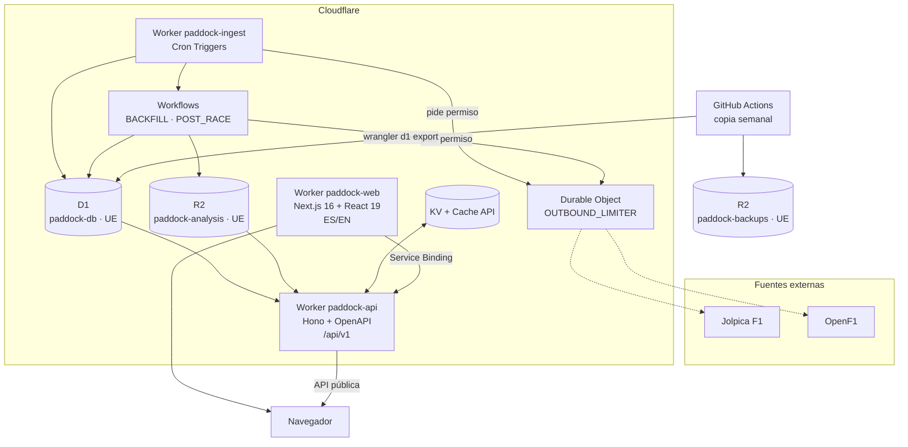

# Paddock Notes — Stack técnico y despliegue en Cloudflare

> Stack completo con todo desplegado en Cloudflare: web, API, base de datos, almacenamiento, tareas programadas, email y analítica.
> Información de la plataforma comprobada en la documentación oficial el 5 de noviembre de 2026. Las decisiones y sus motivos están en [decisiones.md](decisiones.md) (`D-xx`).

## 1. Resumen

| Capa | Tecnología | Servicio de Cloudflare |
|---|---|---|
| Web | Next.js 16 + React 19 + TypeScript | Workers con OpenNext (D-03) |
| Estáticos | CSS, fuentes, JS del cliente, SVG | Workers Static Assets |
| Visualización | D3 (solo cálculo) + SVG en JSX | — (se ejecuta en el navegador y en el servidor) |
| Contenido | MDX en el repositorio | Se compila en el build |
| API pública | Hono + Zod + OpenAPI | Worker `paddock-api` |
| Base de datos | SQLite con Drizzle ORM | D1, jurisdicción UE (D-13) |
| Caché de datos | Respuestas JSON con TTL | Cache API + KV |
| Análisis precalculados | JSON por carrera y herramienta | R2, jurisdicción UE |
| Ingesta programada | TypeScript | Worker `paddock-ingest` con Cron Triggers |
| Cargas largas y análisis | Pasos con reintentos y pausas | Workflows `BACKFILL` y `POST_RACE` |
| Cálculo de análisis | TypeScript (`packages/analysis`) | Dentro del Workflow `POST_RACE` (D-08) |
| Limitador saliente | Contador global por fuente | Durable Object `OUTBOUND_LIMITER` (D-10) |
| Protección de la API | Límite por IP | Rate Limiting binding |
| Email (fases 4 y 5) | Enlaces mágicos, avisos, newsletter | Email Service (D-16) |
| Formularios (fases 4 y 5) | Verificación anti-bots | Turnstile |
| Analítica | Sin cookies | Web Analytics |
| Logs y errores | Registro estructurado | Workers Logs (+ Sentry opcional) |
| Dominio | `paddocknotes.dev` (propuesta, D-20) | Registrar + DNS |
| CI/CD | Tests, migraciones, despliegue, copias | GitHub Actions + Wrangler |

**Plan necesario:** Workers Paid (5 USD/mes). Ver §14.

**Un solo lenguaje:** todo el proyecto es TypeScript. No hay Python ni Containers (D-08).

## 2. Decisiones clave

| Tema | Decisión | Ref. |
|---|---|---|
| Punto de partida | Proyecto desde cero, monorepo pnpm | D-01 |
| Renderizado | HTML por petición con CSP con *nonce*; la caché vive en la capa de datos | D-04 |
| Fuentes externas | Solo `paddock-ingest` las llama; la API lee siempre de D1 y R2 | D-05 |
| Zona técnica | OpenF1 + cálculo propio en TypeScript; sin FastF1 | D-08 |
| Licencia | Datos CC BY-NC-SA 4.0; código MIT; proyecto no comercial | D-12 |

## 3. Arquitectura



**Principios:**

1. Ningún Worker que atiende visitas llama a una fuente externa. Solo `paddock-ingest` y sus Workflows hablan con Jolpica y OpenF1, y siempre a través del limitador.
2. La web llama a la API por **Service Binding**: sin salir a internet y sin coste extra por petición.
3. Los análisis se calculan una vez por carrera y se sirven como archivos JSON desde R2.
4. Ningún Worker tiene acceso al bucket de copias de seguridad.

## 4. Web: Next.js 16 + React 19

### 4.1 Despliegue con OpenNext (D-03)

| Aspecto | Detalle |
|---|---|
| Paquete | `@opennextjs/cloudflare` (transforma la salida de `next build` en un Worker) |
| Configuración | `open-next.config.ts` + `wrangler.jsonc` (`main: ".open-next/worker.js"`, `assets: ".open-next/assets"`) |
| Bindings | `getCloudflareContext().env` |
| Service Binding a la API | `services: [{ "binding": "API", "service": "paddock-api" }]` en `wrangler.jsonc` |
| CSP | `middleware.ts` (runtime edge) genera el *nonce* y fija la cabecera; Next.js lo aplica a sus scripts. No se usa `proxy.ts`: su soporte en OpenNext es experimental (D-03) |
| MDX | `@next/mdx` |
| Imágenes OG | `next/og` |
| Scripts | `next dev` en local; `opennextjs-cloudflare build` y `opennextjs-cloudflare deploy` para desplegar |

vinext se descartó tras la comprobación del 5 de noviembre de 2026 (motivos en D-03).

### 4.2 Bibliotecas del frontend

| Necesidad | Elección | Nota |
|---|---|---|
| Lenguaje | TypeScript en modo `strict` | — |
| Estilos | Tokens del brandboard en `globals.css` + CSS Modules | Sin framework de utilidades. Ver [marca.md](marca.md) |
| Tipografía | Archivo (variable en peso y ancho), alojada en el propio sitio | No se carga desde Google Fonts: lo impide la CSP `font-src 'self'` y evita enviar IPs a terceros |
| Gráficos | D3 (escalas, formas, ejes) + SVG en JSX | El renderizado lo hace React; D3 solo calcula |
| Animación (revive la carrera) | `requestAnimationFrame` + SVG | Respeta `prefers-reduced-motion` |
| i18n | Rutas `/[lang]` + diccionarios propios | Sin dependencia extra |
| MDX | Ver §4.1 | Solo contenido del repositorio |
| Imágenes para redes | `next/og` | Plantilla del brandboard (1200×630) |
| Búsqueda | Índice estático generado en el build + búsqueda en el navegador | Sin servicio extra |
| Validación | Zod (compartido con la API) | — |

### 4.3 Renderizado y caché (D-04)

Todas las páginas HTML se renderizan en cada petición, porque la CSP estricta necesita un *nonce* nuevo cada vez. La velocidad se consigue cacheando los **datos**, no el HTML:

| Recurso | Caché |
|---|---|
| Datos de la temporada en curso (calendario, clasificación, próximo GP) | 60 s en Cache API |
| Temporadas pasadas, fichas, histórico | 24 h |
| Resultado de una carrera | 5 min las primeras 48 h, después 24 h |
| JSON de análisis (R2) | Inmutable: la URL lleva la versión |
| JS, CSS, fuentes, SVG | Inmutable (nombre con hash) |
| Explicadores, glosario, guía | MDX compilado en el build; HTML renderizado por petición |
| HTML | `Cache-Control: private, no-store` (lleva *nonce*) |

## 5. API: Worker `paddock-api`

| Elemento | Elección |
|---|---|
| Framework | Hono |
| Validación y OpenAPI | Zod + `@hono/zod-openapi` (documentación en `/api/v1/docs`) |
| Acceso a datos | Drizzle ORM sobre D1, solo con el módulo `f1-read` (D-14) |
| Caché | Cache API con claves normalizadas; KV para lo más leído (próximo GP, clasificación actual) |
| Límite entrante | Rate Limiting binding por IP → 429 con `Retry-After` |
| CORS | `GET` de lectura con `Access-Control-Allow-Origin: *` y sin credenciales; comunidad, solo el origen propio (D-07) |
| Atribución | Cada respuesta lleva `source`, `license` y `updated_at` (D-12) |

**Contrato de errores** (D-06): 400 parámetro inválido · 404 sin datos · 405 método no permitido · 429 límite entrante · 500 error interno · 503 D1 no disponible y sin copia en caché. `X-Data-Stale: true` cuando se sirve una copia en caché porque D1 falla, o cuando la ingesta va retrasada.

## 6. Ingesta: Worker `paddock-ingest`

El Worker no tiene rutas públicas: solo se ejecuta por Cron Triggers y lanza Workflows. Tiene el binding `send_email` (`EMAIL`) para la newsletter, los avisos de la cuenta y los avisos de retención.

### 6.1 Tareas programadas (Cron Triggers)

| Cron (UTC) | Tarea |
|---|---|
| `*/15 * * * *` | Si alguna sesión terminó en las últimas 6 h, reingesta sus resultados y las clasificaciones. Si terminó la carrera y OpenF1 ya tiene la sesión, lanza `POST_RACE`. Si no, no hace nada |
| `0 4 * * *` | Refresco diario del calendario de la temporada en curso y, si la primera sesión del próximo GP empieza en menos de 48 h, aviso de GP (COM-11) |
| `0 5 * * 1` | Revisión semanal de correcciones (sanciones posteriores) de las últimas carreras y retención: cuentas inactivas (aviso y borrado) y altas de newsletter sin confirmar (seguridad.md §17) |
| `0 8 * * 2` | Newsletter: si hubo carrera con resultado en los últimos 7 días, lanza `MAILING` (D-24) |

### 6.2 Workflows

| Workflow | Qué hace |
|---|---|
| `BACKFILL` | Carga del histórico desde 1950: un paso por temporada, con pausas para respetar el límite por hora. Unas 13.000 peticiones, ~33 horas, una sola vez (D-11) |
| `POST_RACE` | Tras cada carrera desde 2023: descarga de OpenF1, cálculo de los cinco análisis, escritura de los JSON en R2 y registro de la versión en `analysis_artifacts` |
| `MAILING` | Newsletter (CON-06) y avisos de la cuenta (COM-11): compone el contenido desde D1 y envía lotes de 40 destinatarios por paso (D-16, D-24) |

### 6.3 Limitador de peticiones salientes (D-10)

- Un **Durable Object** por host lleva la cuenta global, así que el cron y los Workflows comparten el mismo límite aunque se ejecuten a la vez.
- Jolpica: 1/s y 400/h, 300/h para el histórico (bajado tras recibir 429 en las pruebas reales, D-10). OpenF1: 2/s y 25/min. Configurables con `vars`.
- Ante un 429, se respeta `Retry-After`.
- Toda escritura en D1 es **idempotente** (`INSERT ... ON CONFLICT DO UPDATE`): reintentar un paso no duplica datos.
- Todas las peticiones llevan un `User-Agent` propio (`PaddockNotes/<versión> (+https://paddocknotes.dev/about)`), que Jolpica exige.

## 7. Análisis (fase 3)

Los cálculos viven en `packages/analysis` (TypeScript puro, sin dependencias del runtime), con tests sobre respuestas reales de OpenF1 guardadas.

| Herramienta | Datos de OpenF1 | Cálculo |
|---|---|---|
| Estrategia | `stints`, `pit`, `race_control` | Línea de tiempo de stints; periodos de coche de seguridad |
| Ritmo | `laps`, `pit`, `race_control` | Tiempos por vuelta; filtro de vueltas de entrada/salida y neutralizadas; tendencia por stint |
| Telemetría | `laps` + `car_data` y `location` filtrados por piloto e intervalo de la vuelta | Distancia acumulada, remuestreo por distancia, delta; ≤ 300 kB por vista |
| Sectores | `laps` (sectores y minisectores) | Matriz piloto × sector; diferencia con el mejor |
| Revive la carrera | `position`, `laps` | Posición de cada piloto al final de cada vuelta |

Salida: `analysis/{season}/{round}/v{n}/{tool}.json` en R2. Telemetría: un archivo por piloto (`telemetry/{driver}.json`); el delta entre dos pilotos se calcula en el navegador.

## 8. Datos

### 8.1 D1 (base de datos principal)

| Aspecto | Detalle |
|---|---|
| Motor | SQLite gestionado (D1), jurisdicción `eu` (no se puede cambiar después) |
| ORM y migraciones | Drizzle ORM + `drizzle-kit` para generar SQL; aplicación con `wrangler d1 migrations apply` |
| Bases de datos | `paddock-db` (producción) y `paddock-db-preview` (previews) |
| Tamaño | 5 GB incluidos en el plan; máximo 10 GB por base de datos |
| Copias de seguridad | Time Travel (30 días) + exportación semanal a R2 (D-15) |
| Límites a tener en cuenta | 100 parámetros por consulta; 2 MB por fila; 30 s por consulta; escrituras masivas en lotes con `db.batch()` |

**Tablas:** `seasons`, `circuits`, `drivers`, `constructors`, `races`, `sessions`, `results`, `qualifying`, `sprint_results`, `standings_drivers`, `standings_constructors`, `laps`, `pit_stops`, `analysis_artifacts`, `ingest_runs`; en fase 4, `users`, `accounts`, `auth_sessions`, `predictions`, `leagues`, `league_members`, `quiz_answers`; en fase 5, `subscribers`.

**Estimación de tamaño:** la tabla `laps` es la mayor. Jolpica tiene vueltas desde 1996: unas 600 carreras × 20 pilotos × 55 vueltas ≈ 660.000 filas, unos 60–80 MB. Todo el histórico cabe con mucho margen por debajo de 1 GB. La telemetría no va a D1: va a R2.

### 8.2 R2 (archivos)

```
paddock-analysis/                     (jurisdicción UE)
├── analysis/{season}/{round}/v{n}/strategy.json
├── analysis/{season}/{round}/v{n}/pace.json
├── analysis/{season}/{round}/v{n}/telemetry/{driver}.json
├── analysis/{season}/{round}/v{n}/sectors.json
├── analysis/{season}/{round}/v{n}/replay.json
├── og/{season}/{round}/{tool}.png    (solo si se usa el plan B de D-03)
└── circuits/{circuitId}.svg

paddock-backups/                      (jurisdicción UE, sin acceso desde Workers)
└── d1/{fecha}.sql                    (borrado automático a los 90 días)
```

Sin coste de salida de datos. El plan gratuito de R2 incluye 10 GB de almacenamiento al mes.

### 8.3 KV y Cache API

Cache API para todas las respuestas públicas de la API, con claves normalizadas. KV solo para los datos más leídos, como copia de último recurso si D1 falla. Nunca como fuente de verdad.

## 9. Comunidad y email (fases 4 y 5)

| Necesidad | Elección | Ref. |
|---|---|---|
| Autenticación | Better Auth + `drizzleAdapter` sobre `drizzle-orm/d1`; enlace mágico y GitHub/Google | D-17 |
| Email | Email Service (binding `send_email`): 3.000 al mes incluidos; plan B: Resend | D-16 |
| Newsletter | Propia sobre D1: doble confirmación, listas ES/EN, baja en un clic | D-16 |
| Anti-bots | Turnstile | — |
| Sesiones | Cookies `__Host-`, `HttpOnly`, `Secure`, `SameSite=Lax` | — |

## 10. Observabilidad

| Necesidad | Herramienta |
|---|---|
| Logs | Workers Logs (activado con `observability.enabled`) |
| Errores | Sentry (integración oficial con Workers), opcional |
| Analítica de visitas | Cloudflare Web Analytics (sin cookies) |
| Estado de la ingesta | Tabla `ingest_runs` + página interna `/status` (detrás de Access) |
| Salud | `/api/v1/health`, comprobado desde fuera cada 5 min |

**Coste de logs desde el 1 de diciembre de 2026:** Workers Logs pasa a los precios de Cloudflare Observability. El plan de pago incluye 50 GB de ingesta y 12 GB-mes de almacenamiento por ciclo; después, 0,25 USD/GB y 0,10 USD/GB-mes. Con un log estructurado por petición, un proyecto de portfolio queda muy por debajo.

## 11. Seguridad

Resumen; el detalle está en [seguridad.md](seguridad.md).

- Secretos con `wrangler secret put` (nunca en el repositorio ni en `vars`).
- Variables no sensibles en `vars` de Wrangler, para que se vean en los diffs.
- Límite de CPU por invocación en Wrangler (`limits.cpu_ms`).
- CSP estricta con *nonce* y cabeceras de seguridad desde el middleware de Next.js y desde Hono.
- `workers_dev: false` y `preview_urls: false` en producción.
- `pnpm audit` en CI; versiones con al menos 14 días de antigüedad (D-19).

## 12. CI/CD y entornos (D-18)

| Entorno | Web | API | Datos |
|---|---|---|---|
| Local | `pnpm dev` | `wrangler dev` | D1 y R2 locales (Miniflare) |
| Preview | `paddock-web-preview` (detrás de Access) | `paddock-api-preview` | `paddock-db-preview`, buckets de preview |
| Producción | `paddocknotes.dev` | `paddocknotes.dev/api/v1` | `paddock-db` |

**Workflows de GitHub Actions:**

| Archivo | Cuándo | Qué hace |
|---|---|---|
| `ci.yml` | Cada pull request | Lint, tipos, tests unitarios y de Workers, build; despliegue al entorno de preview; Playwright + axe + Lighthouse CI contra la preview (con *service token* de Access) |
| `deploy.yml` | Fusión en `main` | Migraciones de D1 en producción, despliegue de `paddock-api`, `paddock-ingest` y `paddock-web`, comprobación de `/api/v1/health`; si falla, reversión a la versión anterior |
| `backup.yml` | Miércoles, 03:00 UTC | `wrangler d1 export --remote` y subida a `paddock-backups` (D-15) |

## 13. Tests

| Nivel | Herramienta |
|---|---|
| Unitarios (normalización, cálculos, formatos) | Vitest |
| Workers (API, ingesta, D1, KV, R2, Durable Objects) | Vitest con `@cloudflare/vitest-pool-workers` (runtime real) |
| Arquitectura | Test que falla si la API importa el módulo de escritura (D-14) |
| Extremo a extremo | Playwright contra la preview |
| Accesibilidad | axe con Playwright |
| Rendimiento | Lighthouse CI |

Los tests nunca llaman a Jolpica ni a OpenF1: usan respuestas reales guardadas en `fixtures/`.

## 14. Costes estimados

| Concepto | Coste | Nota |
|---|---|---|
| Workers Paid | 5 USD/mes | 10 millones de peticiones y 30 millones de ms de CPU al mes; los estáticos no cuentan |
| D1 | Incluido | 25.000 millones de filas leídas y 50 millones escritas al mes; 5 GB |
| R2 | 0 USD | Dentro de los 10 GB gratuitos |
| KV, Durable Objects, Workflows | Incluidos | Muy por debajo de las cuotas |
| Email Service | Incluido | 3.000 emails al mes; después 0,35 USD por cada 1.000 |
| Workers Logs | Incluido | 50 GB de ingesta al mes |
| Dominio `.dev` | Precio del registro | Cloudflare Registrar vende a precio de coste |
| **Total previsto** | **~5 USD/mes + dominio** | Para el tráfico esperado de un proyecto de portfolio |

## 15. Estructura del repositorio

```
paddock-notes/
├── apps/
│   └── web/                  Next.js 16 + React 19 → Worker paddock-web
│       ├── app/              Páginas (App Router, rutas /[lang])
│       ├── components/       Tablas, gráficos (D3 + SVG) y herramientas de análisis
│       ├── content/          Explicadores y guía en MDX (es/, en/) e índice
│       └── lib/              Cliente de la API, i18n, glosario, notas automáticas
├── workers/
│   ├── api/                  Hono + OpenAPI → Worker paddock-api
│   └── ingest/               Cron, Workflows BACKFILL y POST_RACE, Durable Object → Worker paddock-ingest
├── packages/
│   ├── db/                   Esquema Drizzle, migraciones D1, f1-read (+ f1-history) y f1-write
│   ├── shared/               Contrato de la API, esquemas Zod de Jolpica y OpenF1, utilidades
│   └── analysis/             Cálculos de la zona técnica (TypeScript puro)
├── e2e/                      Playwright + axe (escritorio, móvil, modo oscuro)
├── fixtures/                 Respuestas reales de Jolpica y OpenF1 para tests
├── scripts/local-stack.sh    Stack local completo
├── docs/                     Documentación del proyecto
├── .github/workflows/        ci.yml, deploy.yml, backup.yml
├── pnpm-workspace.yaml
├── LICENSE                   MIT (código)
└── CLAUDE.md
```

Gestor de paquetes: pnpm 10 con workspaces, fijado en `packageManager`.

## 16. Configuración de ejemplo (Wrangler)

Los ID reales se generan al crear los recursos.

**`workers/api/wrangler.jsonc`**

```jsonc
{
  "$schema": "../../node_modules/wrangler/config-schema.json",
  "name": "paddock-api",
  "main": "src/index.ts",
  "compatibility_date": "2026-11-05",
  "compatibility_flags": ["nodejs_compat"],
  "workers_dev": false,
  "preview_urls": false,
  "observability": { "enabled": true },
  "limits": { "cpu_ms": 50 },
  "d1_databases": [
    { "binding": "DB", "database_name": "paddock-db", "database_id": "<id>", "migrations_dir": "../../packages/db/migrations" }
  ],
  "kv_namespaces": [{ "binding": "CACHE", "id": "<id>" }],
  "r2_buckets": [{ "binding": "ANALYSIS", "bucket_name": "paddock-analysis", "jurisdiction": "eu" }],
  "ratelimits": [
    { "name": "RATE_LIMIT_READ", "namespace_id": "1001", "simple": { "limit": 60, "period": 60 } }
  ],
  "vars": { "SITE_URL": "https://paddocknotes.dev" },
  "env": {
    "preview": {
      "name": "paddock-api-preview",
      "d1_databases": [{ "binding": "DB", "database_name": "paddock-db-preview", "database_id": "<id>", "migrations_dir": "../../packages/db/migrations" }],
      "kv_namespaces": [{ "binding": "CACHE", "id": "<id-preview>" }],
      "r2_buckets": [{ "binding": "ANALYSIS", "bucket_name": "paddock-analysis-preview", "jurisdiction": "eu" }],
      "vars": { "SITE_URL": "https://paddock-web-preview.<subdominio>.workers.dev" }
    }
  }
}
```

**`workers/ingest/wrangler.jsonc`**

```jsonc
{
  "$schema": "../../node_modules/wrangler/config-schema.json",
  "name": "paddock-ingest",
  "main": "src/index.ts",
  "compatibility_date": "2026-11-05",
  "compatibility_flags": ["nodejs_compat"],
  "workers_dev": false,
  "preview_urls": false,
  "observability": { "enabled": true },
  "triggers": { "crons": ["*/15 * * * *", "0 4 * * *", "0 5 * * 1", "0 8 * * 2"] },
  "d1_databases": [{ "binding": "DB", "database_name": "paddock-db", "database_id": "<id>" }],
  "r2_buckets": [{ "binding": "ANALYSIS", "bucket_name": "paddock-analysis", "jurisdiction": "eu" }],
  "durable_objects": { "bindings": [{ "name": "OUTBOUND_LIMITER", "class_name": "OutboundLimiter" }] },
  "migrations": [{ "tag": "v1", "new_sqlite_classes": ["OutboundLimiter"] }],
  "workflows": [
    { "name": "paddock-backfill", "binding": "BACKFILL", "class_name": "BackfillWorkflow" },
    { "name": "paddock-post-race", "binding": "POST_RACE", "class_name": "PostRaceWorkflow" }
  ],
  "vars": {
    "JOLPICA_BASE_URL": "https://api.jolpi.ca/ergast/f1",
    "OPENF1_BASE_URL": "https://api.openf1.org/v1",
    "JOLPICA_MAX_PER_SECOND": "2",
    "JOLPICA_MAX_PER_HOUR": "400",
    "OPENF1_MAX_PER_SECOND": "2",
    "OPENF1_MAX_PER_MINUTE": "25"
  }
}
```

## 17. Puesta en marcha (orden recomendado)

1. Crear la cuenta de Cloudflare con 2FA (llave o passkey) y activar Workers Paid cuando se vaya a desplegar.
2. Comprar el dominio (D-20) en Cloudflare Registrar; activar DNSSEC.
3. Instalar dependencias (`pnpm install`) y autenticarse en Wrangler (`wrangler login`).
4. Comprobar `pnpm --filter web build:worker` (build de OpenNext) en local.
5. Crear los recursos con jurisdicción UE: `wrangler d1 create paddock-db --jurisdiction eu` (y `paddock-db-preview`), `wrangler r2 bucket create paddock-analysis --jurisdiction eu` (y `paddock-analysis-preview`, `paddock-backups`), `wrangler kv namespace create CACHE` (y el de preview).
6. Aplicar las migraciones en local y en remoto.
7. Desplegar `paddock-ingest` y cargar la temporada en curso. **La web no se publica hasta que D1 tiene la temporada en curso (D-05).**
8. Lanzar `BACKFILL` para el histórico (fase 2).
9. Desplegar `paddock-api` y `paddock-web`; conectar el dominio.
10. Configurar Access para el entorno de preview y `/status`; activar Web Analytics.
11. Configurar los secretos de GitHub (tokens de Cloudflare por entorno) y activar `backup.yml`.

## 18. Riesgos

| Riesgo | Mitigación |
|---|---|
| OpenNext exige versiones recientes de Next.js en su rango de `peerDependencies` | Actualizar los dos a la vez con Renovate, respetando D-19 |
| Renderizar todo por petición cuesta CPU y puede subir el LCP | Caché de datos agresiva; Lighthouse CI con umbral; revisar D-04 si el LCP en móvil supera 2,5 s |
| OpenF1 pierde el acceso a los datos de F1 | Los análisis guardados en R2 son permanentes; aviso en la zona técnica si no hay datos nuevos (D-08) |
| Jolpica baja sus límites (lo ha anunciado) | Límites configurables y respeto de `Retry-After`; el histórico se carga una sola vez |
| D1 es SQLite: algunas consultas de récords pueden ser lentas | Índices, tablas precalculadas tras cada GP y `EXPLAIN QUERY PLAN` |
| Email Service está en beta | Plan B con Resend (D-16) |
| Cambios de precios o límites de Cloudflare | Revisar la documentación al empezar cada fase |

## Fuentes

Ver la lista completa en [decisiones.md](decisiones.md#fuentes-consultadas-el-5-de-noviembre-de-2026). Plataforma:

- Next.js en Workers (vinext): https://developers.cloudflare.com/workers/framework-guides/web-apps/nextjs/
- OpenNext: https://developers.cloudflare.com/workers/framework-guides/web-apps/opennext/
- Precios de Workers: https://developers.cloudflare.com/workers/platform/pricing/
- Límites de D1: https://developers.cloudflare.com/d1/platform/limits/
